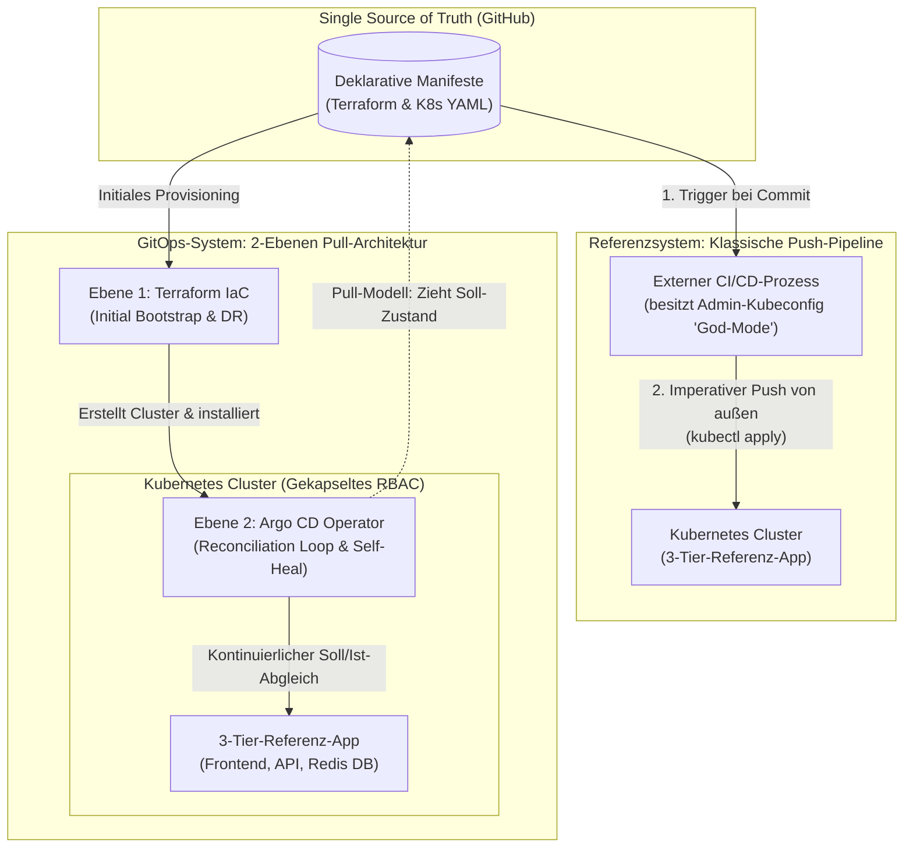
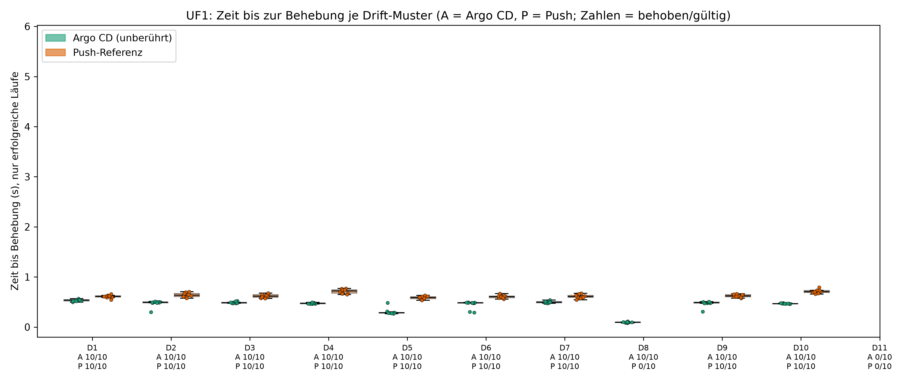
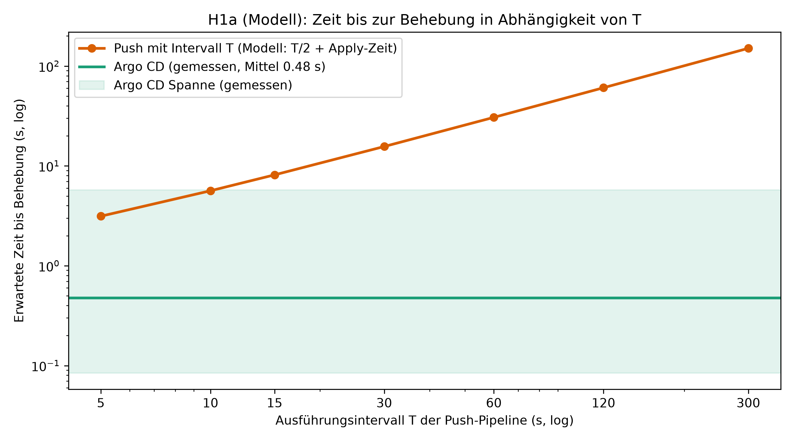
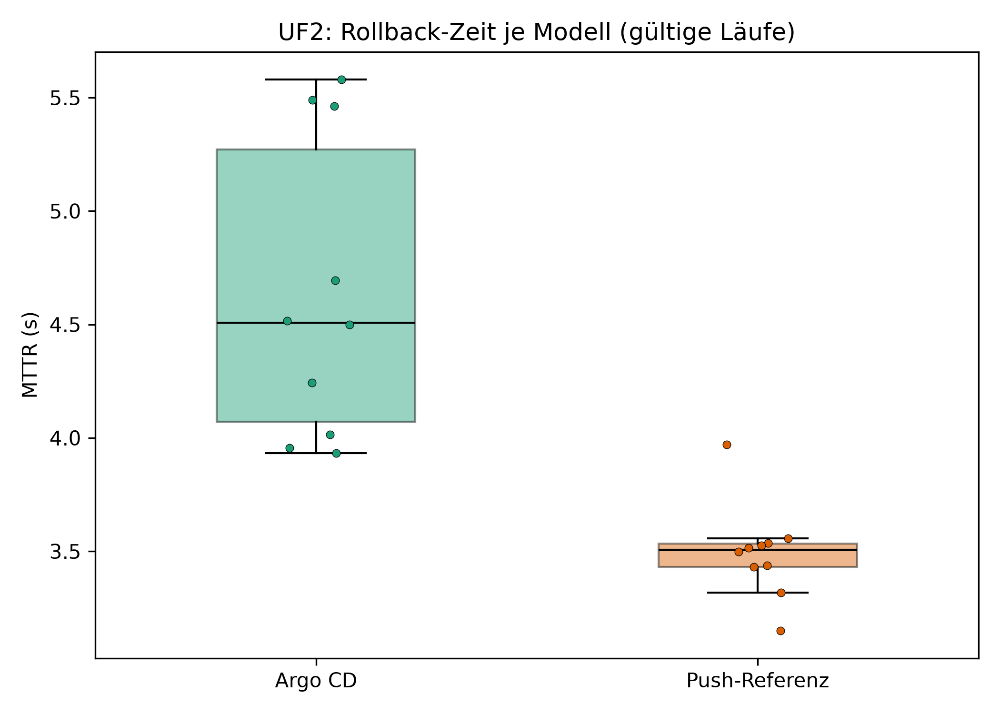
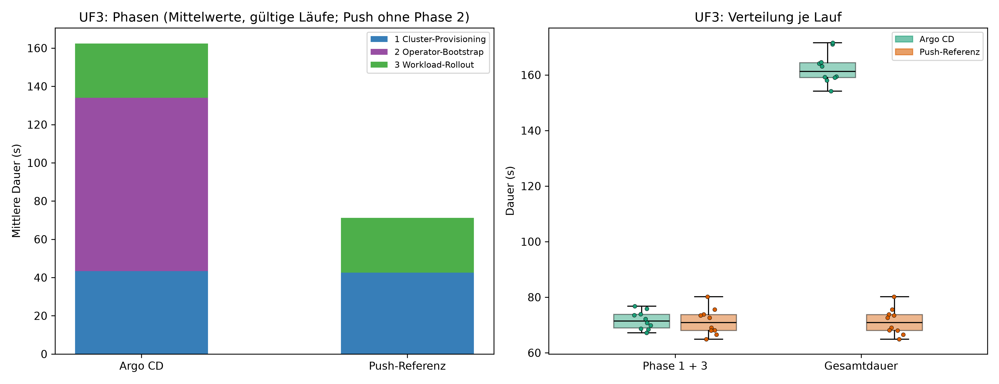

# Empirical Benchmark: GitOps (Terraform & Argo CD) vs. Push-Based CI/CD Pipelines in Kubernetes


-success)

Dieses Repository enthält das technische Artefakt (Demonstrator & automatisierte Benchmark-Suite) zur Bachelorarbeit:

> **„Konfigurationsdrift und Systemresilienz im Vergleich: Ein empirischer Vergleich Push-basierter Deployment-Pipelines und eines GitOps-Ansatzes mit Terraform und Argo CD in Kubernetes-Umgebungen“**  
> *Autor: Timo Peters | Studiengang: Informatik (B.Sc.) | Internationale Hochschule (IU)*

---

## 1. Motivation & Problemstellung

In Cloud-nativen Kubernetes-Umgebungen stoßen klassische, **Push-basierte CI/CD-Pipelines** im laufenden Betrieb (*Day-2-Operations*) auf drei strukturelle Schwachstellen:
1. **Configuration Drift:** Manuelle Eingriffe, Hotfixes (`kubectl edit/scale/patch`) oder eingeschleuste Schatten-Ressourcen führen zu einer Abweichung zwischen dem realen Laufzeitzustand (*Ist-Zustand*) und dem im Git-Repository definierten *Soll-Zustand*. Ereignisgesteuerte Push-Pipelines sind im Laufzeitbetrieb blind für solche Drifts.
2. **Sicherheits- & Berechtigungsrisiken („God-Mode“):** Externe CI/CD-Runner benötigen weitreichende administrative Cluster-Zugangsdaten (`admin-kubeconfig` / Cluster-Admin-Tokens), was die Angriffsfläche bei einer Kompromittierung des CI-Systems drastisch erhöht.
3. **Wiederherstellungsaufwand (MTTR & Disaster Recovery):** Rollbacks nach fehlerhaften Releases und die vollständige Re-Initialisierung nach einem Totalausfall erfordern im Push-Modell mehrstufige, imperative Prozessketten und einen erneuten Export von Cluster-Zertifikaten.

Dieses Projekt untersucht empirisch, inwiefern eine deklarative **2-Ebenen-GitOps-Architektur** (**Ebene 1:** Basis-Provisioning via *Terraform*, **Ebene 2:** kontinuierliches In-Cluster-Workload-Management via *Argo CD*) diese Schwachstellen überwindet und wo die architektonischen Grenzen beider Modelle liegen.

---

## 2. Forschungsfragen & Hypothesen

### 2.1 Forschungsfragen
* **Hauptforschungsfrage:** Inwiefern unterscheidet sich ein deklarativer GitOps-Ansatz (Terraform & Argo CD) von einer konventionellen, Push-basierten Deployment-Pipeline hinsichtlich Konfigurationskonsistenz, Drift Detection und Mean Time to Recovery (MTTR) in einer Cloud-nativen Kubernetes-Umgebung?
* **UF1 (Drift & Konsistenz):** Wie verhalten sich beide Deployment-Modelle bei unautorisierten manuellen Änderungen am Laufzeitzustand (Configuration Drift) hinsichtlich Erkennungsdauer und automatisierter Korrektur?
* **UF2 (Resilienz & Recovery):** Welche quantitativen Unterschiede zeigen sich bei der Wiederherstellungszeit (MTTR) nach einem fehlerhaften Release oder einem simulierten Systemausfall?
* **UF3 (Betriebsaufwand & Reproduzierbarkeit):** In welchem Maße unterscheidet sich der manuelle Betriebsaufwand für die vollständige Re-Initialisierung einer Umgebung zwischen beiden Ansätzen?

### 2.2 Untersuchte Hypothesen & Prüfmatrix

| ID | Hypothese laut Exposé | Untersuchungsbereich | Empirische Prüfmethode | Befund / Entscheidung |
| :--- | :--- | :---: | :--- | :--- |
| **H1a** | Der GitOps-basierte Pull-Ansatz weist bei nicht-autorisierten Laufzeitänderungen eine signifikant geringere *Drift Detection Time* auf als eine Push-Pipeline mit festem Ausführungsintervall. | **UF1** | Analytisches Erwartungswertmodell $\mathcal{U}(0, T)$ mit Sensitivitätsanalyse ($T \in [5, 300]\text{ s}$) vs. In-Cluster-Regelkreis. | **Bestätigt** (Argo CD um Faktor 6,6 bis 315 schneller; Push ereignisgesteuert = 0 % Erkennung). |
| **H1b** | Der GitOps-basierte Pull-Ansatz erreicht bei den definierten Configuration-Drift-Szenarien eine höhere *Drift Recovery Rate* als die konventionelle Push-Pipeline. | **UF1** | Exakter Fisher-Test je Drift-Muster ($m=11$ Tests, Holm-korrigiert) über $N = 220$ Läufe. | **Differenziert bestätigt** (Vorsprung beruht spezifisch auf Pruning unautorisierter Objekte [D8: 10/10 vs. 0/10]; D11 scheitert bei beiden [0/10]). |
| **H2** | Die *Mean Time to Recovery (MTTR)* bei einem fehlerhaften Release ist im GitOps-Modell durch ein Git-basiertes Rollback signifikant geringer als bei einer konventionellen Push-Pipeline. | **UF2** | Mann-Whitney-U-Test über $N = 20$ Läufe im alternierenden ABBA-Design nach Git-Commit des Fehlreleases. | **Widerlegt** (Push im Median um 1,00 s schneller, da GitOps einen schreibenden `git push` benötigt; GitOps bietet dafür volle Git-Auditierbarkeit). |
| **H3a** | Die Anzahl manueller Eingriffe bei einer vollständigen Cluster-Re-Initialisierung ist im GitOps-Modell signifikant geringer als bei sequenziellen Push-Skripten. | **UF3** | Deskriptive Auswertung formaler Zählregeln (`n_commands`, `n_credential_transfers`) nach Totalausfall. | **Bestätigt** (Wegfall des sicherheitskritischen Kubeconfig-Exports; 0 vs. 1 externer Credential-Transfer). |
| **H3b** | Trotz des initialen Mehraufwands für das Bootstrapping des In-Cluster-Operators unterscheidet sich die Gesamtdauer der Re-Initialisierung zwischen dem GitOps- und dem Push-Modell nicht statistisch signifikant. | **UF3** | Mann-Whitney-U-Test der 3-Phasen-Zerlegung über $N = 20$ Läufe im ABBA-Design. | **Widerlegt für Gesamtdauer** (Argo CD ~91 s langsamer, verursacht zu 99,5 % durch Phase 2 [Helm-Bootstrap]; Phase 1 + 3 sind mit $\Delta = 0,48\text{ s}$ nicht signifikant verschieden). |

---

## 3. Systemarchitektur im Vergleich



---

## 4. Untersuchungsdesign & Methodik

Beide Deployment-Modelle werden auf identischer Infrastruktur (`Kind v0.33.0`, Node-Image `v1.37.0`) anhand einer **3-Tier-Referenzapplikation** (*Nginx-Frontend*, *HTTP-Echo Backend-API*, *Redis-Datenbank*) in drei experimentellen Szenarien verglichen:

* **UF1-B (Natural Self-Healing & Konsistenz, N = 220):** Automatisierte Injektion von 11 definierten Konfigurationsdrifts (`D1`–`D11`) über jeweils 10 vollständige Zyklen ($N = 110$ je Modell). Argo CD operiert dabei im unberührten Regelkreis (`selfHeal: true`, `prune: true`) ohne externen Skript-Eingriff während des 20-sekündigen Messfensters. Um künstliche Verzerrungen durch den bekannten Backoff-Zähler-Bug in Argo CD `v2.13.2` ([GitHub-Issue #21599](https://github.com/argoproj/argo-cd/issues/21599), behoben ab [Pull Request #22095](https://github.com/argoproj/argo-cd/pull/22095)) auszuschließen, wird der exponentielle Backoff vorab über `controller.self.heal.backoff.timeout.seconds: "0"` deaktiviert (`make patch-argocd`)[cite: 24, 29].
* **UF2 (Resilienz & Release-Rollback, N = 20):** Messung der *Mean Time to Recovery (MTTR in s)* nach dem Ausrollen eines fehlerhaften Container-Releases (`nginx:broken-release-999`), das in beiden Modellen symmetrisch per Git-Commit eingespielt wird[cite: 28]. Zur Eliminierung von Host- und Cache-Sequenzeffekten erfolgt die Messung im alternierenden **ABBA-Counterbalancing-Design** nach einem vorgeschalteten Warm-up-Zyklus[cite: 28].
* **UF3 (Disaster Recovery & 3-Phasen-Zerlegung, N = 20):** Messung der *Disaster Recovery Duration (s)* in drei isolierten Phasen (**Phase 1:** Cluster-Provisioning via identischem Terraform-Befehl, **Phase 2:** Operator-Bootstrap via Helm, **Phase 3:** Workload-Rollout) sowie Erfassung der zustandsändernden Befehle (`n_commands`) und externen Credential-Transfers (`n_credential_transfers`) im ABBA-Design[cite: 26].

### Katalog der 11 Drift-Muster (`benchmark-suite/run_natural_selfheal.py`)

| ID | Drift-Kategorie | Injektions-Vektor (Live-Cluster Sabotage) | Geprüfte Sicherheits-/Betriebsdimension |
| :--- | :--- | :--- | :--- |
| **D1** | Horizontale Skalierung | `kubectl scale deploy frontend --replicas=5` (Soll: 2) | Kapazitäts- & Replikations-Konsistenz[cite: 27] |
| **D2** | Unautorisiertes Image-Tag | `kubectl set image deploy/backend-api api=hashicorp/http-echo:0.2.3` | Versions- & Supply-Chain-Integrität[cite: 27] |
| **D3** | Start-Parameter-Manipulation | `kubectl patch deploy backend-api` (`args[0] = "-text=MANIPULIERT"`) | Konfigurations-Integrität zur Laufzeit[cite: 27] |
| **D4** | Service-Port-Verstellung | `kubectl patch svc frontend-service` (`targetPort`: 80 $\rightarrow$ 8080) | Netzwerk-Verfügbarkeit (Service-Routing)[cite: 27] |
| **D5** | Komponenten-Löschung | `kubectl delete svc frontend-service` | Selbstheilung gelöschter Teil-Objekte[cite: 27] |
| **D6** | Datenbank-Env-Modifikation | `kubectl set env deploy/database REDIS_AOF_ENABLED=yes` (Soll: `no`) | Schutz deklarierter Umgebungsvariablen[cite: 27] |
| **D7** | Ressourcen-Limit-Drift | `kubectl set resources deploy/frontend -c=web --limits=memory=512Mi` | Quality-of-Service (QoS) & Limit-Durchsetzung[cite: 27] |
| **D8** | Schatten-Ressource (*Shadow-IT*) | `kubectl create cm rogue-config` (mit App-Tracking-Kontext) | Bereinigung fremder Objekte (*Declarative Pruning*)[cite: 27] |
| **D9** | SecurityContext-Eskalation | `allowPrivilegeEscalation: false` $\rightarrow$ `true` | DevSecOps-Compliance & Privilegien-Schutz[cite: 27] |
| **D10** | Service-Selector-Hijacking | `kubectl patch svc frontend-service` (`selector.tier`: frontend $\rightarrow$ backend) | Schutz vor interner Traffic-Umleitung[cite: 27] |
| **D11** | Additive Env-Injection | `kubectl set env deploy/database UNBEFUGTER_ZUGRIFF=true` (nicht im Manifest) | Grenze deklarativer Patch-Semantik (*Strategic Merge Patch*)[cite: 27] |

---

## 5. Zentrale Ergebnisse & Visualisierungen

Die statistische Auswertung (`benchmark-suite/evaluate_stats.py`) trennt strikt zwischen **Behebungsraten** (geprüft mittels **exaktem Fisher-Test**) und **Behebungszeiten** (berechnet ausschließlich über erfolgreich behobene Läufe `recovered == 1` ohne künstliche Timeout-Strafwerte, geprüft mittels **Mann-Whitney-U-Test**)[cite: 25]. Zur Kontrolle der Family-Wise Error Rate ($\alpha = 0,05$) werden alle $p$-Werte je Testfamilie nach **Holm-Bonferroni** korrigiert und um **Cliff's Delta ($\delta$)** sowie **95-%-Bootstrap-Konfidenzintervalle** der Median-Differenz ergänzt[cite: 25, 33].

### 5.1 Drift-Behebung im natürlichen Regelkreis (UF1-B, N = 220)

* **Drift Recovery Rate (H1b):** Über alle 11 Muster hinweg behebt Argo CD **90,9 % (100/110)** aller Drifts, während die Push-Referenz (`kubectl apply`) **81,8 % (90/110)** erreicht[cite: 33]. Ohne die Sondermuster `D8` und `D11` erreichen beide Systeme **100 % (90/90)**[cite: 33].
  * **Überlegenheit von GitOps bei Schatten-Ressourcen (`D8`):** Eingeschleuste Objekte im Applikationskontext (`rogue-config`) werden von Argo CD dank `prune: true` zu **100 % (10/10)** in durchschnittlich **0,095 s** entfernt, während ein imperatives `kubectl apply` ohne `--prune` diese vollständig ignoriert (**0/10**, Fisher-Exakt-Test: $p_{\text{Holm}} = 1,19 \times 10^{-4}$)[cite: 33].
  * **Architekturgrenze bei additiven Array-Einträgen (`D11`):** Beim Hinzufügen einer im Manifest nicht deklarierten Umgebungsvariable (`UNBEFUGTER_ZUGRIFF=true`) scheitern **beide** Modelle (**0/10**)[cite: 33]. Da Kubernetes Listenfelder (`env:`) per *Strategic Merge Patch* zusammenführt, bleibt die Variable bestehen; Argo CD meldet hierbei in 10/10 Fällen `Synced` (*State-Inference-Defizit*)[cite: 33].
* **Zeit bis zur Behebung (`recovered == 1`):** Im unberührten Regelkreis ist Argo CD (gepoolter Median: **0,481 s**, Mittelwert: **0,478 s** bzw. **0,425 s** ohne den initialen 5-s-Cooldown in `D1 Lauf 1`) bei allen 9 beidseitig geheilten Mustern signifikant schneller als die Ausführung von `kubectl apply` im Push-Modell (gepoolter Median: **0,620 s**, Mittelwert: **0,635 s**, gepooltes Cliff's Delta $\delta = -0,977$, alle 9 Einzelvergleiche signifikant mit $p_{\text{Holm}} \le 0,0036$)[cite: 33].

| Muster | Argo CD geheilt | Argo Median (Mittel ± SD) | Push geheilt | Push Median (Mittel ± SD) | Median-Diff. (95-%-KI) | $p_{\text{Holm}}$ (MWU / Fisher) |
| :--- | :---: | :---: | :---: | :---: | :---: | :---: |
| **D1** (Replica) | 10/10 | **0,539 s** (1,053 ± 1,647 s) | 10/10 | **0,612 s** (0,610 ± 0,029 s) | $-0,073\text{ s}$ ($[-0,097; -0,055]$) | **0,0036** ($\delta = -0,78$)[cite: 33] |
| **D2** (Image) | 10/10 | **0,494 s** (0,476 ± 0,063 s) | 10/10 | **0,637 s** (0,639 ± 0,043 s) | $-0,143\text{ s}$ ($[-0,182; -0,108]$) | **0,0014** ($\delta = -1,00$)[cite: 33] |
| **D3** (Args) | 10/10 | **0,482 s** (0,489 ± 0,016 s) | 10/10 | **0,619 s** (0,619 ± 0,034 s) | $-0,137\text{ s}$ ($[-0,167; -0,103]$) | **0,0014** ($\delta = -1,00$)[cite: 33] |
| **D4** (Port) | 10/10 | **0,474 s** (0,474 ± 0,010 s) | 10/10 | **0,722 s** (0,714 ± 0,044 s) | $-0,248\text{ s}$ ($[-0,278; -0,197]$) | **0,0014** ($\delta = -1,00$)[cite: 33] |
| **D5** (Delete Svc) | 10/10 | **0,284 s** (0,304 ± 0,064 s) | 10/10 | **0,591 s** (0,585 ± 0,030 s) | $-0,308\text{ s}$ ($[-0,325; -0,273]$) | **0,0014** ($\delta = -1,00$)[cite: 33] |
| **D6** (Env Mod) | 10/10 | **0,482 s** (0,447 ± 0,080 s) | 10/10 | **0,610 s** (0,606 ± 0,031 s) | $-0,128\text{ s}$ ($[-0,204; -0,100]$) | **0,0014** ($\delta = -1,00$)[cite: 33] |
| **D7** (Resources) | 10/10 | **0,498 s** (0,498 ± 0,018 s) | 10/10 | **0,611 s** (0,611 ± 0,039 s) | $-0,110\text{ s}$ ($[-0,145; -0,088]$) | **9,74e-05** ($\delta = -1,00$)[cite: 33] |
| **D8** (Rogue CM) | **10/10** | **0,094 s** (0,095 ± 0,008 s) | **0/10** | — (*nicht behoben*) | Rate: $+100\text{ \%}$ | **1,19e-04** *(Fisher)*[cite: 33] |
| **D9** (SecContext) | 10/10 | **0,488 s** (0,472 ± 0,058 s) | 10/10 | **0,624 s** (0,623 ± 0,029 s) | $-0,136\text{ s}$ ($[-0,164; -0,110]$) | **0,0014** ($\delta = -1,00$)[cite: 33] |
| **D10** (Selector) | 10/10 | **0,467 s** (0,469 ± 0,006 s) | 10/10 | **0,705 s** (0,711 ± 0,037 s) | $-0,238\text{ s}$ ($[-0,266; -0,219]$) | **0,0014** ($\delta = -1,00$)[cite: 33] |
| **D11** (Add Env) | **0/10** | — (*nicht behoben, Synced*) | **0/10** | — (*nicht behoben*) | Rate: $0\text{ \%}$ | **1,0000** *(Fisher)*[cite: 33] |



### 5.2 Analytisches Modell & Sensitivitätsanalyse zu H1a

Da eine ereignisgesteuerte Push-Pipeline ohne Commit keinen Drift erkennt (**Erkennungsrate 0 %**)[cite: 33], wird für eine periodisch im Intervall $T$ ausgeführte Push-Pipeline die Wartezeit über $\mathcal{U}(0, T)$ mit $\mathbb{E}[\text{Push-Gesamt}] = T/2 + \bar{t}_{\text{apply}}$ ($\bar{t}_{\text{apply}} = 0,635\text{ s}$) modelliert[cite: 33]. Gegenüber dem gemessenen Argo-CD-Mittelwert (**0,478 s**) ergibt sich bereits bei $T = 5\text{ s}$ ein Geschwindigkeitsvorteil um den **Faktor 6,6** ($3,14\text{ s}$), bei $T = 60\text{ s}$ um den **Faktor 64,1** ($30,64\text{ s}$) und bei $T = 300\text{ s}$ um den **Faktor 315,2** ($150,64\text{ s}$)[cite: 33]:



### 5.3 Release-Rollback / MTTR (UF2, N = 20)

Beim Rollback eines per Git-Commit ausgerollten Fehlreleases benötigt die Push-Referenz (`git fetch` + `git checkout` + `kubectl apply`) im Median **3,506 s** (Mittelwert: **3,494 ± 0,208 s**, **3 Befehle**, nutzt externe Admin-Kubeconfig), während Argo CD (`git revert` + `git push` + Webhook-Refresh) im Median **4,508 s** (Mittelwert: **4,639 ± 0,653 s**, **2 Befehle**, keine externe Kubeconfig) benötigt ($p_{\text{Holm}} = 1,73 \times 10^{-4}$, $\delta = +0,96$, Median-Differenz: **$+1,002\text{ s}$**)[cite: 33]. Die zusätzliche Sekunde im GitOps-Modell resultiert aus dem schreibenden `git push` des Revert-Commits zu GitHub, garantiert im Gegenzug jedoch eine lückenlose, revisionssichere Git-Historie ohne neuen Konfigurationsdrift (**H2 differenziert widerlegt**).



### 5.4 Disaster Recovery & 3-Phasen-Zerlegung (UF3, N = 20)

Die Re-Initialisierung nach einem kompletten Cluster-Abriss (`destroy_all`) im ABBA-Design isoliert den Einfluss des Operator-Bootstrappings präzise[cite: 26]:

| Phase / Metrik | Argo CD (Median; Mittel ± SD) | Push-Referenz (Median; Mittel ± SD) | Median-Diff. (95-%-KI) | $p_{\text{Holm}}$ (MWU) / Befund |
| :--- | :---: | :---: | :---: | :--- |
| **Phase 1: Cluster-Provisioning (Terraform)** | **42,12 s** (43,35 ± 3,11 s) | **41,65 s** (42,52 ± 2,98 s) | $+0,475\text{ s}$ ($[-2,10; +5,57]$) | **$p_{\text{Holm}} = 1,0000$ ($\delta = +0,06$, identisches Tooling)**[cite: 33] |
| **Phase 2: Operator-Bootstrap (Helm)** | **90,94 s** (90,72 ± 4,32 s) | *(entfällt: 0,00 s)* | — | Image-Pull (~240 MB) & Start der 7 Argo-CD-Pods[cite: 33] |
| **Phase 3: Workload-Rollout (3-Tier-App)** | **27,88 s** (28,36 ± 1,35 s) | **27,84 s** (28,71 ± 3,23 s) | $+0,040\text{ s}$ ($[-4,07; +2,75]$) | **$p_{\text{Holm}} = 1,0000$ ($\delta = 0,00$, kein Unterschied)**[cite: 33] |
| **Summe Phase 1 + 3 (Ohne Operator)** | **71,47 s** (71,71 ± 3,25 s) | **70,84 s** (71,23 ± 4,72 s) | $+0,630\text{ s}$ ($[-4,30; +5,68]$) | **$p_{\text{Holm}} = 1,0000$ ($\delta = +0,16$, Differenz Mittel 0,48 s)**[cite: 33] |
| **Gesamtdauer ($t_{\text{total}}$, H3b)** | **161,28 s** (162,43 ± 5,61 s) | **70,84 s** (71,23 ± 4,72 s) | **$+90,435\text{ s}$** ($[+85,55; +96,72]$) | **$p_{\text{Holm}} = 5,41\text{e-}5$ ($\delta = +1,00$, H3b widerlegt)**[cite: 33] |
| **Externe Credential-Transfers (H3a)** | **0 Transfers** | **1 Transfer** (`admin-kubeconfig`) | — | **Kein Export privilegierter Cluster-Keys bei GitOps**[cite: 33] |

Von der mittleren Gesamtdifferenz (**91,20 s**) entfallen **90,72 s (99,5 %)** isoliert auf Phase 2 (Operator-Bootstrap); die reine Infrastruktur- und Anwendungsbereitstellung (**Phase 1 + 3: 71,71 s vs. 71,23 s**) unterscheidet sich um lediglich **0,48 s** ($p_{\text{Holm}} = 1,0000$)[cite: 33].



---

## 6. Projektstruktur

```text
bachelor-gitops-demo/
├── infrastructure/
│   └── main.tf                                   # Ebene 1: Terraform IaC (Kind-Cluster & Argo CD Helm-Release)
├── workloads/
│   ├── argocd-app.yaml                           # Ebene 2: Deklarative Argo CD Application (inkl. Finalizer & Self-Heal)
│   └── base/
│       └── manifest.yaml                         # 3-Tier-Referenzarchitektur (Frontend, Backend-API, Redis-DB)
├── benchmark-suite/
│   ├── run_natural_selfheal.py                   # Benchmark UF1-B: Unberührtes Self-Healing vs. Push (D1-D11)
│   ├── run_rollback_mttr.py                      # Benchmark UF2: Symmetrisches Release-Rollback & MTTR (ABBA-Design)
│   ├── run_disaster_recovery.py                  # Benchmark UF3: 3-Phasen-Disaster-Recovery & Zählregeln (ABBA-Design)
│   ├── evaluate_stats.py                         # Berechnet MWU, Fisher, Holm-Korrektur, Bootstrap-KI & Plots
│   └── results/
│       ├── natural_selfheal_measurements.csv     # Rohdaten UF1-B (N = 220)
│       ├── mttr_measurements_v2.csv              # Rohdaten UF2 (N = 20)
│       ├── disaster_recovery_measurements_v2.csv # Rohdaten UF3 (N = 20)
│       ├── *.log                                 # Zeitgestempelte Audit-Logs aller Läufe
│       ├── statistical_summary_v2.txt            # Vollständiger statistischer Auswertungsbericht
│       ├── tables/                               # Exportierte Ergebnistabellen (uf1_pattern_table.csv, hypothesis_tests.csv)
│       ├── plots/                                # Generierte Publikationsgrafiken (300 DPI)
│       └── pilot_backoff_investigation/          # Pilotdaten zur Diagnose des Backoff-Bugs #21599
├── requirements.txt                              # Python-Abhängigkeiten für reproduzierbare Auswertung
├── Makefile                                      # Automatisierte Orchestrierung, Pre-Flight-Checks & Patching
└── README.md                                     # Projektdokumentation
```

---

## 7. Schnellstart & Reproduktion der Ergebnisse

### Voraussetzungen
* `docker`, `kind`, `kubectl`, `terraform`, `git` und `python >= 3.10`

### 1. Umgebung initialisieren & Cluster starten
```bash
# Erstellt das Python-venv (.venv), installiert Pakete und initialisiert Terraform
make init

# Baut den Cluster via Terraform auf, wendet den Patch für Bug #21599 an und aktiviert Argo CD
make up
```

### 2. Experimente & Statistische Auswertung ausführen
```bash
# Einzelne Benchmarks starten (Standard: RUNS=10; anpassbar via z. B. RUNS=2 für Pilotläufe):
make test-drift      # UF1-B: Natural Self-Healing & Pruning (D1-D11)
make reset-state     # Bereinigt eventuelle Rückstände aus D8/D11
make test-mttr       # UF2: Symmetrisches Release-Rollback & MTTR (ABBA-Design)
make test-dr         # UF3: 3-Phasen-Disaster-Recovery (Terraform Destroy & Apply)

# Statistische Tests (MWU, Fisher, Holm-Bonferroni, Cliff's Delta) & Grafiken generieren:
make stats

# Oder den gesamten Benchmark-Zyklus am Stück ausführen:
make benchmark-all
```
