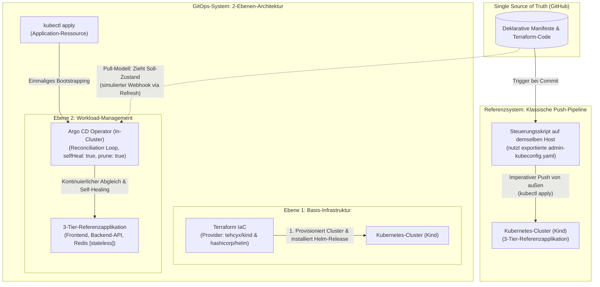

# Empirical Benchmark: GitOps (Terraform & Argo CD) vs. Push-Based CI/CD Pipelines in Kubernetes


-success)


Dieses Repository enthält das technische Artefakt (Demonstrator & automatisierte Benchmark-Suite) zur Bachelorarbeit:

> **„Konfigurationsdrift und Systemresilienz im Vergleich: Ein empirischer Vergleich Push-basierter Deployment-Pipelines und eines GitOps-Ansatzes mit Terraform und Argo CD in Kubernetes-Umgebungen“**  
> *Autor: Timo Peters | Studiengang: Informatik (B.Sc.) | Internationale Hochschule (IU) | Stand: November 2026*

---

## 1. Motivation & Problemstellung

In Cloud-nativen Kubernetes-Umgebungen stoßen klassische, **Push-basierte CI/CD-Pipelines** im laufenden Betrieb (*Day-2-Operations*) auf drei strukturelle Herausforderungen:

1. **Configuration Drift & State-Inference-Defizite:** Manuelle Eingriffe, Ad-hoc-Hotfixes (`kubectl edit/scale/patch`) oder eingeschleuste Schatten-Ressourcen führen zu Abweichungen zwischen dem realen Cluster-Laufzeitzustand (*Ist-Zustand*) und der im Git-Repository versionierten Spezifikation (*Soll-Zustand*). Rein ereignisgesteuerte Push-Pipelines sind im laufenden Betrieb für solche Drifts ohne neuen Commit blind.
2. **Sicherheits- & Berechtigungsrisiken im Regelbetrieb:** Push-Pipelines erfordern für externe CI/CD-Runner dauerhaft exportierte, administrative Cluster-Zugangsdaten (`admin-kubeconfig` / Cluster-Admin-Tokens). Bei GitOps hingegen verlässt im laufenden Betrieb kein administrativer Zugang den Cluster, da ein In-Cluster-Operator den Soll-Zustand per Pull abruft (beim initialen Bootstrapping via Terraform benötigen jedoch beide Modelle Cluster-Zugriff).
3. **Wiederherstellungsaufwand (MTTR & Disaster Recovery):** Rollbacks nach fehlerhaften Releases und die vollständige Re-Initialisierung nach einem Totalausfall können im Push-Modell imperative Prozessketten erfordern. GitOps verspricht hier eine deklarative Rekonstruierbarkeit direkt aus der Versionsverwaltung (Git als *Single Source of Truth*). Bei zustandsbehafteten Systemen (z. B. Datenbanken) beschränkt sich dieser Vorteil allerdings auf die deklarative Spezifikation; persistente Nutzdaten erfordern separate Backup-Operatoren.

Dieses Projekt untersucht anhand eines kontrollierten technischen Vergleichsexperiments im Rahmen des **Design Science Research (DSR)** (nach Hevner et al. 2004 und Peffers et al. 2007) quantitativ und qualitativ, inwiefern eine deklarative **2-Ebenen-GitOps-Architektur** (**Ebene 1:** Basis-Provisioning via *Terraform*, **Ebene 2:** kontinuierliches In-Cluster-Workload-Management via *Argo CD*) diese Herausforderungen gegenüber einer Push-Referenz-Pipeline bewältigt und wo die architektonischen Grenzen beider Ansätze liegen.

---

## 2. Forschungsfragen & Hypothesen

### 2.1 Forschungsfragen

* **Hauptforschungsfrage:** Inwiefern unterscheidet sich ein deklarativer GitOps-Ansatz (Terraform & Argo CD) von einer konventionellen, Push-basierten Deployment-Pipeline hinsichtlich Konfigurationskonsistenz, Drift Detection und Mean Time to Recovery (MTTR) in einer Cloud-nativen Kubernetes-Umgebung?
* **UF1 (Drift & Konsistenz):** Wie verhalten sich beide Deployment-Modelle bei unautorisierten manuellen Änderungen am Laufzeitzustand (Configuration Drift) hinsichtlich Erkennungsdauer und automatisierter Korrektur?
* **UF2 (Resilienz & Recovery):** Welche quantitativen Unterschiede zeigen sich bei der Wiederherstellungszeit (MTTR) nach einem fehlerhaften Release oder einem simulierten Systemausfall?
* **UF3 (Betriebsaufwand & Reproduzierbarkeit):** In welchem Maße unterscheidet sich der manuelle Betriebsaufwand für die vollständige Re-Initialisierung einer Umgebung zwischen beiden Ansätzen?

### 2.2 Untersuchte Hypothesen & Prüfmatrix

Zur Vermeidung von Pseudoreplikation und zur Sicherstellung methodischer Trennschärfe ordnet die Prüfmatrix jeder Hypothese eine klar definierte Metrik (abhängige Variable), die eingesetzte Prüfmethode und den empirischen Befund zu:

| ID | Hypothese laut Exposé | Bereich | Zugeordnete Metrik (Abhängige Variable) | Empirische Prüfmethode | Befund / Entscheidung |
| :--- | :--- | :---: | :--- | :--- | :--- |
| **H1a** | Der GitOps-basierte Pull-Ansatz weist bei nicht-autorisierten Laufzeitänderungen eine signifikant geringere *Drift Detection Time* auf als eine Push-Pipeline mit festem Ausführungsintervall. | **UF1** | Zeit bis zur Behebung ($t_{\text{remed}}$ in $\text{s}$) / Modellierte Push-Gesamtzeit $\mathbb{E}[t_{\text{push}}](T)$ | Gemessen: $t_{\text{remed}}$ von Argo CD und einmaliger `kubectl apply`. Push mit Intervall $T$ analytisch modelliert ($\mathcal{U}(0,T)$); kein Signifikanztest auf Modellwerte. | **Modellbasiert gestützt**, Erkennungszeit nicht separat gemessen. Ereignisgesteuerter Push erkennt ohne Commit keinen Drift (0 % Erkennungsrate). Argo-Werte gelten bei deaktiviertem Backoff und $\ge 7\text{ s}$ Drift-Abstand. |
| **H1b** | Der GitOps-basierte Pull-Ansatz erreicht bei den definierten Configuration-Drift-Szenarien eine höhere *Drift Recovery Rate* als die konventionelle Push-Pipeline. | **UF1** | Drift Recovery Rate ($\text{DRR}$ in $\%$) je Muster | Exakter Fisher-Test je Drift-Muster ($n = 10$ vs. $n = 10$, $m = 11$ Tests, Holm-korrigiert). | **Nur für D8 gestützt** ($10/10$ vs. $0/10$, $p_{\text{Holm}} = 1{,}19 \times 10^{-4}$; Tracking-Kontext manuell gesetzt). Ohne D8 **kein Unterschied** ($90/100$ vs. $90/100 = 90{,}0\text{ \%}$); ohne D8 und D11: $90/90$ vs. $90/90 = 100\text{ \%}$. D11 bei beiden $0/10$ (`Synced`). |
| **H2** | Die *Mean Time to Recovery (MTTR)* bei einem fehlerhaften Release ist im GitOps-Modell durch ein Git-basiertes Rollback signifikant geringer als bei einer konventionellen Push-Pipeline. | **UF2** | Technische Wiederherstellungsdauer / *Rollback Duration* ($\text{MTTR}$ in $\text{s}$) | Mann-Whitney-U-Test, Cliff's Delta, 95-%-Bootstrap-KI ($n = 10$ je Modell, alternierende Reihenfolge, Fehlrelease per Git-Commit). | **Nicht gestützt** (Gegenrichtung: Push im Median um $1{,}00\text{ s}$ schneller; $p_{\text{Holm}} = 1{,}73 \times 10^{-4}$, $\delta = +0{,}96$; Webhook simuliert). |
| **H3a** | Die Anzahl manueller Eingriffe bei einer vollständigen Cluster-Re-Initialisierung ist im GitOps-Modell signifikant geringer als bei sequenziellen Push-Skripten. | **UF3** | `n_commands` (ergänzend: `n_credential_transfers`) | Deskriptive Auswertung nach vorab definierter Zählregel, kein Signifikanztest (da deterministisch ohne Zufallsstreuung). | **Nicht gestützt** ($3$ gegen $3$ Befehle nach Zählregel). Zusatzbefund: Bei Push verlässt ein Admin-Zugang den Cluster ($1$ gegen $0$). |
| **H3b** | Trotz des initialen Mehraufwands für das Bootstrapping des In-Cluster-Operators unterscheidet sich die Gesamtdauer der Re-Initialisierung zwischen dem GitOps- und dem Push-Modell nicht statistisch signifikant. | **UF3** | Disaster-Recovery-Dauer ($\text{s}$): Phase 1, Phase 2, Phase 3, Phase 1 + 3, Gesamt | Mann-Whitney-U-Test, Cliff's Delta, 95-%-Bootstrap-KI je Phase und Gesamt ($n = 10$ je Modell, alternierende Reihenfolge, Holm-Korrektur). | **Nicht gestützt für die Gesamtdauer** (Median $+90{,}4\text{ s}$ bei GitOps durch Phase 2, $p_{\text{Holm}} = 5{,}41 \times 10^{-5}$, $\delta = +1{,}00$). Phase 1 + 3: **kein Hinweis auf einen Unterschied** (Median-Differenz $+0{,}63\text{ s}$, 95-%-KI $[-4{,}30; +5{,}68]\text{ s}$, $p_{\text{Holm}} = 1{,}00$). |

---

## 3. Systemarchitektur im Vergleich

Das Experiment vergleicht zwei klar getrennte Bereitstellungsparadigmen auf derselben Host-Infrastruktur:



### Komponenten & Versionen

* **Infrastruktur & Laufzeitumgebung:**
  * Host-System: Dedizierte virtuelle Maschine (Ubuntu 24.04 LTS, 4 vCPUs, 8 GB RAM).
  * Kubernetes: Lokaler Single-Node-Cluster via `Kind v0.33.0` (Node-Image `kindest/node:v1.37.0`, `kubectl v1.37.1`).
  * Infrastruktur-as-Code (Ebene 1): `Terraform v1.16.6` mit Providern `tehcyx/kind ~> 0.6.0` und `hashicorp/helm ~> 2.12.0`.
  * GitOps-Operator (Ebene 2): `Argo CD v2.13.2` (Helm-Chart `argo-cd` Version 7.7.12) im Namespace `argocd`.
  * Auswertungs-Toolchain: `Python 3.14.3`, `scipy 1.18.1`, `pandas 3.0.6`, `numpy 2.5.4`.
* **Application-CRD:** Die deklarative Application-Ressource (`workloads/argocd-app.yaml`) wird separat via `kubectl apply` eingespielt, da Kubernetes-CRDs nicht ohne Weiteres im selben Terraform-Lauf wie der Cluster geplant werden können. Ein Ein-Befehl-Bootstrap wurde nicht untersucht.
* **Push-Referenz:** Zur Vermeidung von Runner-Warteschlangen und externen Provisionierungslatenzen als kontrolliertes Skript auf demselben Host realisiert; greift über die exportierte Datei `admin-kubeconfig.yaml` auf den Cluster zu.

---

## 4. Untersuchungsdesign & Methodik

Beide Deployment-Modelle werden anhand einer **3-Tier-Referenzapplikation** (5 Pods im Namespace `default`, bewusst ohne separaten Namespace, um zusätzliche RBAC- und Namespace-Overheads als Störvariablen auszuschließen) in drei experimentellen Szenarien verglichen.

### 3-Tier-Referenzapplikation

| Tier | Kubernetes-Objekte | Container-Image | Deklarierte Konfiguration & Rolle im Experiment |
| :--- | :--- | :--- | :--- |
| **Datenbank** | `Deployment/database` (1 Replica, Port 6379) | `redis:7.2-alpine` | **Zustandslos betrieben (In-Memory ohne `PersistentVolume`)**, deklarierte Env: `REDIS_AOF_ENABLED: "no"`. Ziel für Variablen-Drift (D6, D11). |
| **Backend-API** | `Deployment/backend-api` (2 Replikate, Port 5678) | `hashicorp/http-echo:1.0` | Start-Argument: `-text=API-Status: OK (Soll-Zustand)`. Ziel für Image- (D2) und Argument-Manipulation (D3). |
| **Frontend** | `Deployment/frontend` (2 Replikate, Port 80)<br/>`Service/frontend-service` (ClusterIP, Port 80 $\rightarrow$ 80) | `nginx:1.27-alpine` | Ressourcen: Limits `128Mi`/`200m`, Requests `64Mi`/`100m`. SecurityContext: `allowPrivilegeEscalation: false`. Ziel für Skalierung (D1), Routing (D4, D10), Löschung (D5), Limits (D7), Security (D9) und Release-Rollback (UF2). |

> [!NOTE]
> Die Datenbank wird bewusst **zustandslos ohne `PersistentVolume`** betrieben: Gegenstand der Untersuchung ist die Rekonstruktion deklarativer Infrastruktur- und Workload-Spezifikationen, nicht das Backup- und Restore-Management persistenter Datenbestände.

### Experimentelle Szenarien

* **UF1-B (Drift-Behebung im natürlichen Regelkreis, N = 220):**
  * Automatisierte Injektion von 11 definierten Konfigurationsdrifts (`D1`–`D11`) über jeweils 10 vollständige Zyklen ($n = 10$ je Modell und Muster).
  * Argo CD operiert im unberührten Regelkreis (`selfHeal: true`, `prune: true`) ohne externen Skript-Eingriff während des 20-sekündigen Messfensters; Push führt je Lauf genau einen `kubectl apply`-Befehl aus (Prozessstart in der Zeit enthalten).
  * **Argo-CD-Backoff-Patch:** Um Verzerrungen durch den Self-Heal-Backoff-Zähler zu vermeiden, der sich in der eingesetzten Argo-CD-Version (v2.13.2) nach erfolgreicher Heilung nicht zurücksetzte (beobachtetes Verhalten), wird der exponentielle Backoff vorab über `controller.self.heal.backoff.timeout.seconds: "0"` in `argocd-cmd-params-cm` deaktiviert (`make patch-argocd`, Mindestabstand `controller.self.heal.timeout.seconds: 5`). Dies weicht von der Standardkonfiguration ab.
  * **Störgrößenkontrolle:** UF1 lief blockweise (GitOps vollständig vor Push), da alle Container-Images im lokalen Node-Cache vorlagen. Diagnosen bestätigten die Abwesenheit eines Zeittrends ($\rho \approx 0{,}01$). Zur Vermeidung von Pseudoreplikation werden alle statistischen Tests strikt getrennt je Drift-Muster gerechnet; gepoolte Werte werden ausschließlich deskriptiv ausgewiesen.
* **UF2 (Resilienz & Release-Rollback, N = 20):**
  * Messung der reinen technischen **Rollback Duration** ($\text{s}$) ab Auslösung des Rollbacks, nachdem ein fehlerhaftes Release (`nginx:broken-release-999`) in beiden Modellen symmetrisch per Git-Commit ausgerollt wurde.
  * **Begriffliche Abgrenzung:** Vorgelagerte Zeiten für Monitoring-Detektion und menschliche Triage nach DORA werden bewusst ausgeklammert, um die plattformseitige Ausführungszeit isoliert zu vergleichen.
  * Zur Kontrolle von Caching- und Reihenfolgeeffekten im alternierenden **ABBA-Counterbalancing-Design** ($n = 10$ je Modell) nach einem vorgeschalteten, ungespeicherten Warm-up-Zyklus ausgeführt. Webhook bei GitOps per Refresh-Annotation simuliert.
* **UF3 (Disaster Recovery & Cluster-Re-Initialisierung, N = 20):**
  * Simulierter Totalausfall (`terraform destroy -auto-approve` & `kind delete cluster`, reguläres Leeren des lokalen Terraform-States) im ABBA-Design ($n = 10$ je Modell, inklusive Warm-up).
  * Isolierte Messung in drei Phasen:
    * **Phase 1:** Cluster-Provisioning via `terraform apply -target=kind_cluster.bachelor_cluster -auto-approve` (identisch in beiden Modellen).
    * **Phase 2:** Operator-Bootstrap via Helm (`terraform apply -auto-approve`, entfällt konstruktionsbedingt bei Push).
    * **Phase 3:** Workload-Rollout (GitOps: `kubectl apply -f workloads/argocd-app.yaml`; Push: Export der Kubeconfig und `kubectl apply -f workloads/base/manifest.yaml`).
  * Erfassung deterministischer Zählregeln: zustandsändernde Befehle (`n_commands`) und externe Credential-Transfers (`n_credential_transfers`).

### Taxonomie der 11 Drift-Muster (`benchmark-suite/run_natural_selfheal.py`)

Der Katalog stand vor der Hauptmessung fest und deckt sowohl Standard-Modifikationen als auch strukturelle Grenzfälle der Zustandskonsolidierung systematisch ab:

| ID | Kategorie (Deskriptive Taxonomie) | Injektions-Vektor (Laufzeit-Manipulation) | Verifikation (Erwarteter Soll-Zustand) | Geprüfte Betriebs-/Sicherheitsdimension |
| :--- | :--- | :--- | :--- | :--- |
| **D1** | 1. Bestehende Felder ändern (Skalar) | `kubectl scale deployment frontend --replicas=5` | `spec.replicas == 2` | Kapazitäts- & Replikations-Konsistenz |
| **D2** | 2. Bestehende Listeneinträge ändern | `kubectl set image deployment/backend-api api=hashicorp/http-echo:0.2.3` | Image: `hashicorp/http-echo:1.0` | Versions- & Supply-Chain-Integrität |
| **D3** | 2. Bestehende Listeneinträge ändern | `kubectl patch deployment backend-api` (`args[0] = "-text=MANIPULIERT"`) | `args[0]` enthält `"OK (Soll-Zustand)"` | Konfigurations-Integrität zur Laufzeit |
| **D4** | 2. Bestehende Listeneinträge ändern | `kubectl patch svc frontend-service` (`targetPort`: 80 $\rightarrow$ 8080) | `targetPort == 80` | Netzwerk-Verfügbarkeit (Service-Routing) |
| **D5** | 3. Deklariertes Objekt löschen | `kubectl delete svc frontend-service` | Service `frontend-service` existiert wieder | Selbstheilung gelöschter Teil-Objekte |
| **D6** | 2. Bestehende Listeneinträge ändern | `kubectl set env deployment/database REDIS_AOF_ENABLED=yes` | Variable `REDIS_AOF_ENABLED == "no"` | Schutz deklarierter Umgebungsvariablen |
| **D7** | 2. Bestehende Listeneinträge ändern | `kubectl set resources deployment/frontend -c=web --limits=memory=512Mi` | Limit: `memory == 128Mi` | Quality-of-Service (QoS) & Limit-Schutz |
| **D8** | 4a. Nicht deklarierte Ressourcen (Objekt) | `kubectl create cm rogue-config` *(mit Tracking-Label & Annotation)* | ConfigMap `rogue-config` existiert nicht | Bereinigung fremder Objekte (*Declarative Pruning*) |
| **D9** | 2. Bestehende Listeneinträge ändern | `kubectl patch deployment frontend` (`allowPrivilegeEscalation: false` $\rightarrow$ `true`) | `allowPrivilegeEscalation == false` | DevSecOps-Compliance & Privilegien-Schutz |
| **D10** | 1. Bestehende Felder ändern (Map) | `kubectl patch svc frontend-service` (`selector.tier`: frontend $\rightarrow$ backend) | `selector.tier == "frontend"` | Schutz vor internem Traffic-Hijacking |
| **D11** | 4b. Nicht deklarierte Einträge (Feld) | `kubectl set env deployment/database UNBEFUGTER_ZUGRIFF=true` | Variable nicht mehr in `env`-Liste | Grenze deklarativer Patch-Semantik (*Strategic Merge Patch*) |

---

## 5. Zentrale Ergebnisse & Statistische Auswertung

Die Auswertung (`benchmark-suite/evaluate_stats.py`) trennt strikt zwischen **Behebungsraten** (geprüft mittels **exaktem Fisher-Test**) und **Behebungszeiten** (berechnet ausschließlich über erfolgreich behobene Läufe `recovered == 1` ohne künstliche Timeout-Strafwerte, geprüft mittels **Mann-Whitney-U-Test**). Zur Kontrolle der Family-Wise Error Rate ($\alpha = 0{,}05$) werden alle $p$-Werte je Testfamilie nach **Holm-Bonferroni** korrigiert und um **Cliff's Delta ($\delta$)** sowie **95-%-Bootstrap-Konfidenzintervalle** (5.000 Replikationen, Seed 42) der Median-Differenz ergänzt.

### 5.1 Drift-Behebung im natürlichen Regelkreis (UF1-B, N = 220)

* **Drift Recovery Rate (H1b):** Über alle 11 Muster hinweg behebt Argo CD **90,9 % (100/110)** aller Drifts, während die Push-Referenz (`kubectl apply`) **81,8 % (90/110)** erreicht.
  * Ohne `D8`: Beide Modelle erreichen identisch **90,0 % (90/100)**.
  * Ohne `D8` und `D11`: Beide Modelle erreichen identisch **100 % (90/90)**.
  * **Pruning von Schatten-Ressourcen (`D8`):** Eingeschleuste Objekte (`rogue-config`) werden von Argo CD dank `prune: true` zu **100 % (10/10)** in median **0,094 s** (Mittelwert: 0,095 s) entfernt, während ein imperatives `kubectl apply` ohne `--prune` diese ignoriert (**0/10**, Fisher-Exakt-Test: $p_{\text{roh}} = 1{,}08 \times 10^{-5}$, $p_{\text{Holm}} = 1{,}19 \times 10^{-4}$). Dieser Wert liegt an der zeitlichen Messauflösungsgrenze; Argo CD bereinigt die ConfigMap zudem im Experiment nur aufgrund des manuell gesetzten Tracking-Kontexts.
  * **Architekturgrenze bei additiven Listeneinträgen (`D11`):** Beim Hinzufügen einer im Manifest nicht deklarierten Umgebungsvariable scheitern **beide** Modelle (**0/10**). Da Kubernetes Listenfelder (`env:`) per *Strategic Merge Patch* zusammenführt, bleibt die Variable bestehen; Argo CD meldet hierbei in 10/10 Fällen `Synced` (*State-Inference-Defizit*).
* **Zeit bis zur Behebung (`recovered == 1`):** Im unberührten Regelkreis war die Zeit bis zur Behebung bei Argo CD (gepoolter Median: **0,481 s**, Mittelwert: **0,478 s** bzw. **0,425 s** ohne den ungeklärten Ausreißer D1 Lauf 1 [5,741 s]) bei allen 9 beidseitig geheilten Mustern kürzer als bei `kubectl apply` im Push-Modell (gepoolter Median: **0,620 s**, Mittelwert: **0,635 s**, alle 9 Einzelvergleiche signifikant mit $p_{\text{Holm}} \le 0{,}0036$).
  * Die Unterschiede betragen lediglich **0,07 bis 0,31 s**. Die Push-Zeit enthält konstruktionsbedingt den Prozessstart von `kubectl apply`; jede Verifikation kostet die Laufzeit eines `kubectl get` (Auflösung etwa 0,05 bis 0,1 s).
  * **Diagnosen:** Muster-bereinigt zeigte sich kein Zusammenhang zwischen Heal-Zähler und Zeit (Spearman 0,01, $p = 0{,}91$; Zählerbereich 4 bis 102) und kein Zeittrend über die Läufe ($\rho \approx 0{,}01$ bei beiden Modellen). Dies bestätigt, dass der deaktivierte Backoff keine Restwirkung entfaltete.

| Muster | Argo CD geheilt | Argo Median (Mittel ± SD) | Push geheilt | Push Median (Mittel ± SD) | Median-Diff. (95-%-KI) | $p_{\text{roh}}$ (Methode) | $p_{\text{Holm}}$ (MWU / Fisher) | Cliff's Delta ($\delta$) |
| :--- | :---: | :---: | :---: | :---: | :---: | :---: | :---: | :---: |
| **D1** (Replica) | 10/10 | **0,539 s** (1,053 ± 1,647 s) | 10/10 | **0,612 s** (0,610 ± 0,029 s) | $-0,073\text{ s}$ ($[-0,097; -0,055]$) | 0,0036 (asympt.) | **0,0036** | $-0,78$ (groß) |
| **D2** (Image) | 10/10 | **0,494 s** (0,476 ± 0,063 s) | 10/10 | **0,637 s** (0,639 ± 0,043 s) | $-0,143\text{ s}$ ($[-0,183; -0,108]$) | 1,82e-04 (asympt.) | **0,0014** | $-1,00$ (groß) |
| **D3** (Args) | 10/10 | **0,482 s** (0,489 ± 0,016 s) | 10/10 | **0,619 s** (0,619 ± 0,034 s) | $-0,137\text{ s}$ ($[-0,167; -0,103]$) | 1,81e-04 (asympt.) | **0,0014** | $-1,00$ (groß) |
| **D4** (Port) | 10/10 | **0,474 s** (0,474 ± 0,010 s) | 10/10 | **0,722 s** (0,714 ± 0,044 s) | $-0,248\text{ s}$ ($[-0,278; -0,197]$) | 1,80e-04 (asympt.) | **0,0014** | $-1,00$ (groß) |
| **D5** (Delete Svc) | 10/10 | **0,284 s** (0,304 ± 0,064 s) | 10/10 | **0,591 s** (0,585 ± 0,030 s) | $-0,308\text{ s}$ ($[-0,325; -0,273]$) | 1,82e-04 (asympt.) | **0,0014** | $-1,00$ (groß) |
| **D6** (Env Mod) | 10/10 | **0,482 s** (0,447 ± 0,080 s) | 10/10 | **0,610 s** (0,606 ± 0,031 s) | $-0,128\text{ s}$ ($[-0,204; -0,100]$) | 1,81e-04 (asympt.) | **0,0014** | $-1,00$ (groß) |
| **D7** (Resources) | 10/10 | **0,498 s** (0,498 ± 0,018 s) | 10/10 | **0,607 s** (0,611 ± 0,039 s) | $-0,110\text{ s}$ ($[-0,145; -0,088]$) | 1,08e-05 (exakt) | **9,74e-05** | $-1,00$ (groß) |
| **D8** (Rogue CM) | **10/10** | **0,094 s** (0,095 ± 0,008 s) | **0/10** | — (*nicht behoben*) | Rate: $+100\text{ \%}$ | 1,08e-05 (exakt) | **1,19e-04** *(Fisher)* | $\Delta\text{Rate} = 1{,}0$ |
| **D9** (SecContext) | 10/10 | **0,488 s** (0,472 ± 0,058 s) | 10/10 | **0,624 s** (0,623 ± 0,029 s) | $-0,136\text{ s}$ ($[-0,164; -0,110]$) | 1,82e-04 (asympt.) | **0,0014** | $-1,00$ (groß) |
| **D10** (Selector) | 10/10 | **0,467 s** (0,469 ± 0,006 s) | 10/10 | **0,705 s** (0,711 ± 0,037 s) | $-0,238\text{ s}$ ($[-0,266; -0,219]$) | 1,82e-04 (asympt.) | **0,0014** | $-1,00$ (groß) |
| **D11** (Add Env) | **0/10** | — (*nicht behoben, Synced*) | **0/10** | — (*nicht behoben*) | Rate: $0\text{ \%}$ | 1,0000 (exakt) | **1,0000** *(Fisher)* | $\Delta\text{Rate} = 0{,}0$ |


### 5.2 Analytisches Modell & Sensitivitätsanalyse zu H1a

Eine rein ereignisgesteuerte Push-Pipeline erkennt ohne neuen Commit architektonisch keinen Drift (**Erkennungsrate 0 %**). Ein empirischer Signifikanztest gegen ein willkürliches Cron-Intervall würde lediglich eine Konfigurationsentscheidung statt einer Architektureigenschaft testen. Daher wird die Wartezeit einer periodisch im Intervall $T$ ausgeführten Pipeline analytisch über $\mathcal{U}(0, T)$ mit $\mathbb{E}[\text{Wartezeit}] = T/2$ modelliert ($\mathbb{E}[\text{Push-Gesamt}] = T/2 + \bar{t}_{\text{apply}}$ mit $\bar{t}_{\text{apply}} = 0{,}635\text{ s}$).

Gegenüber dem gemessenen Argo-CD-Mittelwert (**0,478 s**) ergeben sich als deterministische Modellwerte (ohne Signifikanztest; gültig bei deaktiviertem Backoff und $\ge 7\text{ s}$ Drift-Abstand):

| Intervall $T$ | $\mathbb{E}[\text{Wartezeit}]$ | $P_{95}[\text{Wartezeit}]$ | $\mathbb{E}[\text{Push-Gesamt}]$ | Faktor zu Argo CD |
| :---: | :---: | :---: | :---: | :---: |
| **5 s** | 2,5 s | 4,75 s | **3,14 s** | **6,6 $\times$** |
| **10 s** | 5,0 s | 9,50 s | **5,64 s** | **11,8 $\times$** |
| **15 s** | 7,5 s | 14,25 s | **8,14 s** | **17,0 $\times$** |
| **30 s** | 15,0 s | 28,50 s | **15,64 s** | **32,7 $\times$** |
| **60 s** | 30,0 s | 57,00 s | **30,64 s** | **64,1 $\times$** |
| **120 s** | 60,0 s | 114,00 s | **60,64 s** | **126,9 $\times$** |
| **300 s** | 150,0 s | 285,00 s | **150,64 s** | **315,2 $\times$** |


### 5.3 Release-Rollback / MTTR (UF2, N = 20)

Beim Rollback eines per Git-Commit ausgerollten Fehlreleases benötigt die Push-Referenz (`git fetch` + `git checkout` + `kubectl apply`) im Median **3,506 s** (Mittelwert: **3,494 ± 0,208 s**, **3 Befehle**, nutzt externe Admin-Kubeconfig), während Argo CD (`git revert` + `git push` + simulierter Webhook) im Median **4,508 s** (Mittelwert: **4,639 ± 0,653 s**, **2 Befehle**, keine externe Kubeconfig) benötigt ($p_{\text{roh}} = 4{,}33 \times 10^{-5}$, $p_{\text{Holm}} = 1{,}73 \times 10^{-4}$, $\delta = +0{,}96$, Median-Differenz: **$+1,002\text{ s}$** [$+0,509; +1,970]\text{ s}$).

* **Ursachenanalyse aus den Audit-Logs:** Die Git-Operationen dauern in beiden Modellen vergleichbar lang (`git push` bei GitOps: ca. 2,6 s; `git fetch` bei Push: ca. 2,5 s). Der Unterschied entsteht in der anschließenden Rollout-Phase: Während Push die Datei direkt imperativ anwendet (ca. 1,0 s bis zur Bereitschaft), muss Argo CD den neuen Commit zunächst selbst abrufen, das Manifest parsen und den Abgleich initiieren (ca. 2,1 s bis zur Bereitschaft; Näherungswerte aus den Logs inklusive Warm-up).
* **Architektur-Trade-off:** Push ist in diesem Szenario bei der reinen Rollback Duration zwar um ca. 1 s schneller, hinterlässt das Git-Repository jedoch zunächst in einem inkonsistenten Zustand (der Git-Revert erfolgt außerhalb der Zeitmessung). GitOps hingegen stellt durch den atomaren `git revert` die vollständige Nachvollziehbarkeit und Revisionssicherheit in der Versionsgeschichte sicher. **H2 ist nicht gestützt.**


### 5.4 Disaster Recovery & 3-Phasen-Zerlegung (UF3, N = 20)

Die Re-Initialisierung nach einem vollständigen Cluster-Abriss (`terraform destroy -auto-approve` & `kind delete cluster`) isoliert den Einfluss des Operator-Bootstrappings präzise:

| Phase / Metrik | Argo CD (Median; Mittel ± SD) | Push-Referenz (Median; Mittel ± SD) | Median-Diff. (95-%-KI) | $p_{\text{roh}}$ (Methode) | $p_{\text{Holm}}$ (MWU) / Befund |
| :--- | :---: | :---: | :---: | :---: | :--- |
| **Phase 1: Cluster-Provisioning (Terraform)** | **42,12 s** (43,35 ± 3,11 s) | **41,65 s** (42,52 ± 2,98 s) | $+0,475\text{ s}$ ($[-2,10; +5,57]$) | 0,8534 (exakt) | **$p_{\text{Holm}} = 1,0000$ ($\delta = +0,06$, kein Unterschied)** |
| **Phase 2: Operator-Bootstrap (Helm)** | **90,94 s** (90,72 ± 4,32 s) | *(entfällt konstruktionsbedingt: 0,00 s)* | — | — | überwiegend Container-Image-Pulls (nicht separat isoliert) |
| **Phase 3: Workload-Rollout (3-Tier-App)** | **27,88 s** (28,36 ± 1,35 s) | **27,84 s** (28,71 ± 3,23 s) | $+0,040\text{ s}$ ($[-4,07; +2,75]$) | 1,0000 (exakt) | **$p_{\text{Holm}} = 1,0000$ ($\delta = 0,00$, kein Unterschied)** |
| **Summe Phase 1 + 3 (Ohne Operator)** | **71,47 s** (71,71 ± 3,25 s) | **70,84 s** (71,23 ± 4,72 s) | $+0,630\text{ s}$ ($[-4,30; +5,68]$) | 0,5787 (exakt) | **$p_{\text{Holm}} = 1,0000$ ($\delta = +0,16$, kein Hinweis auf Unterschied)** |
| **Gesamtdauer ($t_{\text{total}}$, H3b)** | **161,28 s** (162,43 ± 5,61 s) | **70,84 s** (71,23 ± 4,72 s) | **$+90,435\text{ s}$** ($[+85,55; +96,72]$) | 1,08e-05 (exakt) | **$p_{\text{Holm}} = 5,41\text{e-}5$ ($\delta = +1,00$, H3b nicht gestützt)** |
| **Zustandsändernde Befehle (`n_commands`, H3a)** | **3** | **3** | — | — | **Zählregel: gleiche Befehlsanzahl (3 gegen 3)** |
| **Externe Credential-Transfers (H3a)** | **0 Transfers** | **1 Transfer** (`admin-kubeconfig.yaml`) | — | — | **Im Betrieb verlässt kein Admin-Zugang den Cluster** |

* Die mittlere Gesamtdifferenz von **91,20 s** entspricht fast exakt der Dauer der Operator-Phase (**90,72 s**), die im Push-Modell nicht existiert. Für Phase 1 + 3 (71,71 s vs. 71,23 s) ergibt sich **kein Hinweis auf einen Unterschied** (Median-Differenz $+0{,}63\text{ s}$, 95-%-KI $[-4{,}30; +5{,}68]\text{ s}$; dies stellt jedoch mangels vorab definierter Äquivalenzgrenzen keinen formalen TOST-Äquivalenznachweis dar).
* **Zählregeln:** `n_commands` ergab nach der Zählregel zustandsändernder Befehle bei beiden Ansätzen 3 Befehle. Bei Push verlässt jedoch eine administrative Kubeconfig den Cluster (`n_credential_transfers = 1`), während GitOps den laufenden Betrieb ohne externen Credential-Export abwickelt.


### 5.5 Qualitative Bewertung (Sicherheit, Auditierbarkeit)

Ergänzend zu den Laufzeitmessungen werden qualitative Sicherheits- und Betriebsaspekte anhand eines dreistufigen ordinalen Rasters ($0 =$ nicht erfüllt, $1 =$ teilweise erfüllt, $2 =$ vollständig erfüllt) strukturiert bewertet, **um die Bewertung intersubjektiv nachvollziehbar zu machen**:

| Dimension / Kriterium | GitOps (Stufe) | Push-Referenz (Stufe) | Evidenzart |
| :--- | :--- | :--- | :--- |
| **Verzicht auf externen Admin-Zugang im laufenden Betrieb** | **Teilweise erfüllt (1):** Im laufenden Workload-Betrieb kein Credential-Export aus dem Cluster (`n_credential_transfers = 0`); Bootstrapping (Terraform), Application-Apply und Messhost nutzen jedoch Admin-Rechte. | **Nicht erfüllt (0):** Exportierte administrative Kubeconfig muss dauerhaft außerhalb des Clusters für das Bereitstellungsskript vorgehalten werden (`n_credential_transfers = 1`). | Zählregel, Architektur |
| **Auditierbarkeit & Revisionssicherheit** | **Teilweise erfüllt (1):** Änderungen am Soll-Zustand und Rollbacks (`git revert`) laufen lückenlos über Git-Commits. Out-of-Band-Änderungen an Listen (D11) bleiben im Git-Verlauf unsichtbar und wurden als `Synced` gemeldet. Kryptografische Signaturen (GPG) wurden nicht getestet. | **Nicht erfüllt (0):** Rollback über dateibasierten Git-Checkout plus `kubectl apply` hinterlässt keinen Revert-Commit in der Git-Historie; Ad-hoc-Eingriffe gehen am Repository vorbei. | Architektur, Literatur (Beetz & Harrer 2022, Morris 2021), gemessen (D11) |
| **Bereinigung nicht-deklarierter Schatten-Ressourcen (Objekt-Ebene)** | **Teilweise erfüllt (1):** Automatisches Pruning ($10/10$ in D8), jedoch im Experiment nur für Ressourcen innerhalb des Applikationskontexts mit gesetztem Tracking-Label/Annotation wirksam. | **Nicht erfüllt (0):** Nicht-deklarierte Ressourcen werden durch `kubectl apply` nicht entfernt ($0/10$ in D8). | Gemessen (D8), Architektur |
| **Schutz vor zusätzlichen Listeneinträgen (Feld-Ebene)** | **Nicht erfüllt (0):** Zusätzliche Umgebungsvariable wird nicht erkannt und nicht entfernt ($0/10$ in D11; Argo CD meldet `Synced`). | **Nicht erfüllt (0):** Zusätzliche Umgebungsvariable wird durch `kubectl apply` nicht entfernt ($0/10$ in D11). | Gemessen (D11) |

### 5.6 Einschränkungen (Threats to Validity)

1. **Interne Validität:**
   * UF1 lief aus Vereinfachungsgründen blockweise statt alternierend; eine nachgelagerte Korrelationsanalyse zeigte jedoch keinen Zeittrend über die Läufe ($\rho \approx 0{,}01$).
   * Messasymmetrie in UF1: Der Prozessstart von `kubectl apply` ist in der Push-Zeit enthalten, während der Argo-CD-Application-Controller als langlebiger In-Cluster-Daemon operiert.
   * Externe Netzwerklatenz zu GitHub beeinflusst `git push`, `git fetch` und das Argo-CD-Manifest-Pulling in UF2 und UF3.
   * Dauer von Container-Image-Pulls beim Neuaufbau des Kind-Clusters in UF3 (Phase 2 und 3) wurde nicht separat von der Orchestrierungszeit isoliert.
   * Deaktivierung des exponentiellen Self-Heal-Backoffs weicht von der Argo-CD-Standardkonfiguration ab.
2. **Konstruktvalidität:**
   * In UF1 wurde die „Zeit bis zur Behebung“ ($t_{\text{remed}}$) erhoben, da Erkennungs- und Heilungszeit bei unberührtem Self-Healing plattformseitig nicht separat gemessen werden können.
   * H1a für intervallbasierte Push-Pipelines wurde analytisch modelliert ($\mathcal{U}(0, T)$), um keine willkürliche Cron-Konfiguration empirisch zu testen.
   * In UF2 wurde die reine technische *Rollback Duration* ab Befehlsausführung gemessen; vorgelagerte Detektions- und Diagnosezeiten nach DORA blieben unberücksichtigt.
   * UF3 beschränkt sich auf zustandslose Workloads ohne Wiederherstellung persistenter Datenbank-Volumes (`PersistentVolume`).
   * Webhook in UF2 per Refresh-Annotation simuliert (Polling-Latenz ohne Webhook nicht gemessen).
   * Push-Referenz als lokales Skript statt als entfernter CI-Runner implementiert (keine Runner-Queue-Zeiten abgebildet).
   * D8 erforderte manuell gesetzte Tracking-Labels/Annotationen.
   * `n_commands` hängt von der gewählten Befehlszerlegung ab.
3. **Externe Validität:**
   * Lokaler Single-Node-Kind-Cluster auf einer einzelnen virtuellen Maschine bildet keine realen Multi-Node- und Cloud-Provider-Latenzen (z. B. AWS EKS Control-Plane-Provisionierung) ab.
   * Leichtgewichtige 3-Tier-Referenzapplikation ohne komplexe Abhängigkeitsgraphen und ohne Datenbank-Persistenz.
   * Erhebung an einem einzelnen Messtag auf dedizierter VM.
4. **Statistische Schlussvalidität:**
   * Stichprobenumfang von $n = 10$ je Gruppe und Muster (verhindert Pseudoreplikation, birgt jedoch das Risiko, sehr kleine Effekte nicht zu entdecken; die 95-%-Bootstrap-Konfidenzintervalle weisen die verbleibende Schätzunsicherheit explizit aus).
   * Gepoolte UF1-Werte sind gruppiert und werden daher rein deskriptiv berichtet.
   * Zeitliche Auflösungsgrenze des Pollings (`POLL_INTERVAL_S = 0.1 s`) und Overhead jedes `kubectl get` (ca. 50–100 ms).
   * Für Phase 1 + 3 in UF3 liegt kein formaler Äquivalenztest (TOST) vor, da vorab keine Äquivalenzgrenze festgelegt wurde.

### 5.7 Diskussion & Einordnung in die Literatur

* **Kontinuierliche Selbstheilung statt Ausführungsgeschwindigkeit (Beetz & Harrer 2022):** Der messbare Vorteil von GitOps liegt im kontinuierlichen Abgleich ohne externen Anstoß, im deklarativen Pruning verwaister Objekte (D8) und im Wegfall administrativer Zugangsdaten im laufenden Betrieb. Im reinen Ausführungstempo ist GitOps hingegen nicht grundsätzlich überlegen (in UF1 betragen die Unterschiede lediglich 0,07 bis 0,31 s; bei UF2 ist Push um 1,0 s schneller).
* **State-Inference-Defizite bei Strategic Merge Patch (Hassan et al. 2024, Ghosh et al. 2025):** Der Befund bei D11 ($0/10$ Behebung bei gleichzeitig gemeldetem Status `Synced`) bestätigt die in der Literatur beschriebenen Grenzen rein deklarativer Zustandskonsolidierung bei additiven Listeneinträgen in Kubernetes. Mögliche Gegenmaßnahmen (z. B. Server-Side Apply oder deklarative Admission-Policies via Kyverno/Gatekeeper) stellen wichtige Perspektiven für zukünftige Arbeiten dar.
* **Grenzen bei zustandsbehafteten Systemen:** Da GitOps ausschließlich den Soll-Zustand deklarativer Spezifikationen rekonstruiert, erfordert das Disaster Recovery produktiver Datenbanken stets orthogonale Backup-Operatoren (z. B. Velero).

---

## 6. Projektstruktur

```text
bachelor-gitops-demo/
├── infrastructure/
│   └── main.tf                                   # Ebene 1: Terraform IaC (Kind-Cluster & Argo CD Helm-Release)
├── workloads/
│   ├── argocd-app.yaml                           # Ebene 2: Deklarative Argo CD Application (prune: true, selfHeal: true)
│   └── base/
│       └── manifest.yaml                         # 3-Tier-Referenzarchitektur (Frontend, Backend-API, Redis [stateless])
├── benchmark-suite/
│   ├── run_natural_selfheal.py                   # Benchmark UF1-B: Unberührtes Self-Healing vs. Push (D1-D11)
│   ├── run_rollback_mttr.py                      # Benchmark UF2: Symmetrisches Release-Rollback & MTTR (ABBA-Design)
│   ├── run_disaster_recovery.py                  # Benchmark UF3: 3-Phasen-Disaster-Recovery & Zählregeln (ABBA-Design)
│   ├── evaluate_stats.py                         # Berechnet MWU, Fisher, Holm-Korrektur, Bootstrap-KI & Plots
│   └── results/
│       ├── natural_selfheal_measurements.csv     # Rohdaten UF1-B (N = 220)
│       ├── mttr_measurements_v2.csv              # Rohdaten UF2 (N = 20)
│       ├── disaster_recovery_measurements_v2.csv # Rohdaten UF3 (N = 20)
│       ├── *.log                                 # Zeitgestempelte Audit-Logs aller Läufe
│       ├── statistical_summary_v2.txt            # Vollständiger statistischer Auswertungsbericht
│       ├── tables/                               # Tabellen: uf1_pattern_table.csv, hypothesis_tests.csv
│       ├── plots/                                # Publikationsgrafiken: fig1 bis fig4 (300 DPI)
│       └── pilot_backoff_investigation/          # Pilotdaten zur Diagnose des Backoff-Zählers
├── requirements.txt                              # Python-Abhängigkeiten (scipy, pandas, numpy, matplotlib, seaborn)
├── Makefile                                      # Automatisierte Orchestrierung, Checks, Benchmarks & Stats
└── README.md                                     # Projektdokumentation & empirischer Benchmark-Report
```

---

## 7. Schnellstart & Reproduktion der Ergebnisse

### Voraussetzungen

* `docker`, `kind`, `kubectl`, `terraform`, `git` und `python >= 3.10`

### 1. Umgebung initialisieren & Cluster starten

```bash
# 1. Erstellt das Python-venv (.venv), installiert Pakete und initialisiert Terraform
make init

# 2. Baut den Kind-Cluster via Terraform auf, wendet den Backoff-Patch an und aktiviert die 3-Tier-App
make up
```

### 2. Experimente & Statistische Auswertung ausführen

```bash
# Vorabprüfungen für Cluster-Status, Backoff-Patch und Git-Arbeitsbaum ausführen:
make check-env

# Einzelne Benchmarks ausführen (Standard: RUNS=10; überschreibbar mit z. B. RUNS=2):
make test-drift      # UF1-B: Natural Self-Healing & Pruning (D1-D11)
make reset-state     # Bereinigt eventuelle Test-Rückstände (Rogue-ConfigMap, D11-Variable)
make test-mttr       # UF2: Symmetrisches Release-Rollback & MTTR (ABBA-Design)
make test-dr         # UF3: 3-Phasen-Disaster-Recovery (Terraform Destroy & Apply)

# Statistische Tests (MWU, Fisher, Holm-Bonferroni, Cliff's Delta, Bootstrap-KI) & Grafiken erzeugen:
make stats

# Oder den gesamten Benchmark-Zyklus inklusive Aufräumen automatisiert am Stück durchführen:
make benchmark-all
```
