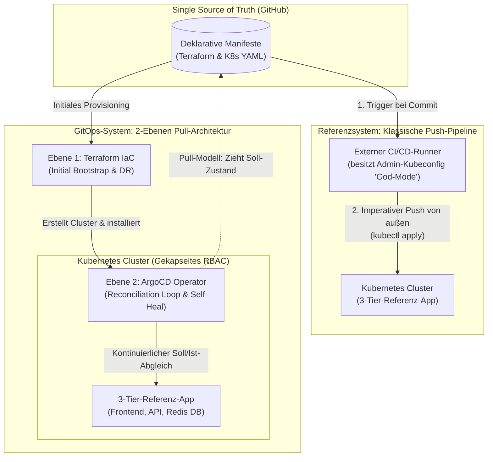
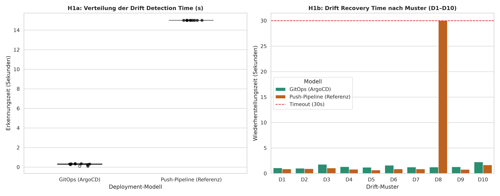
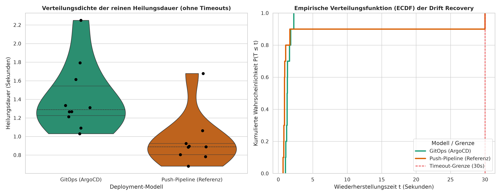
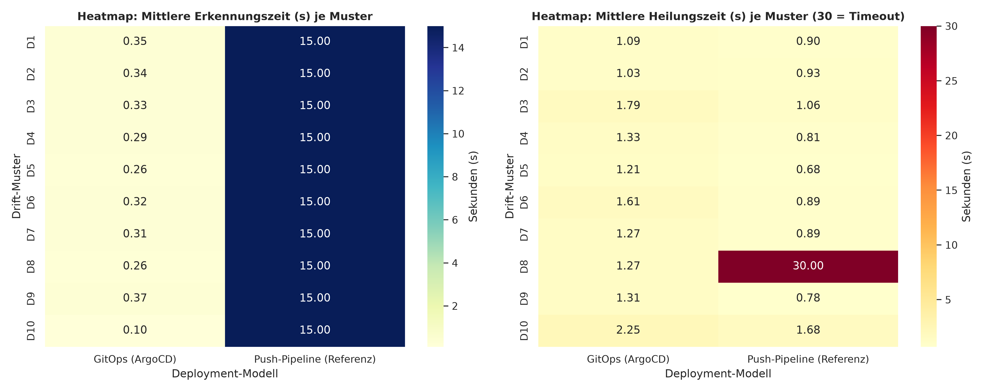
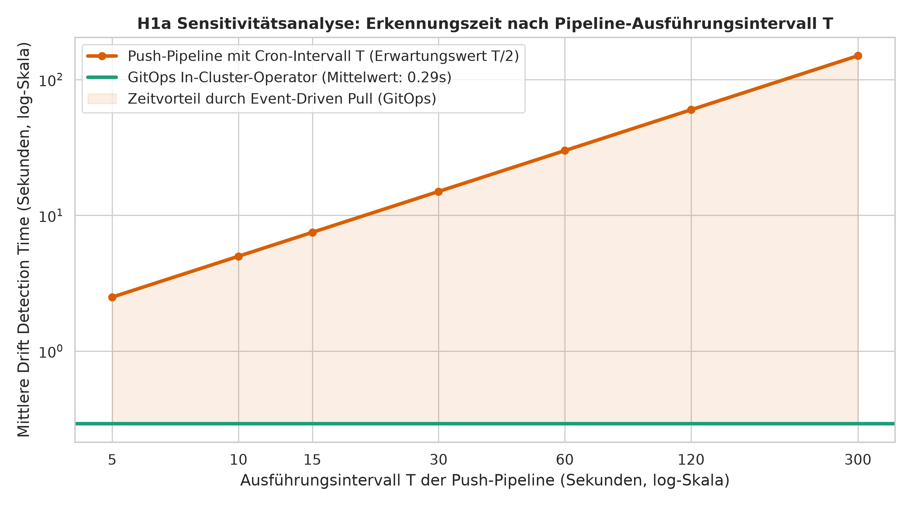
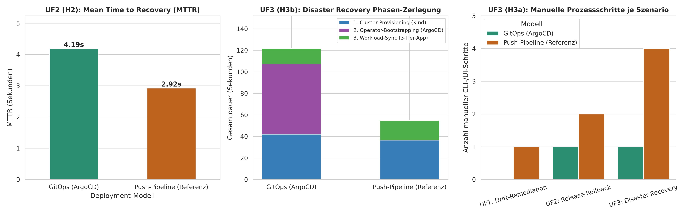
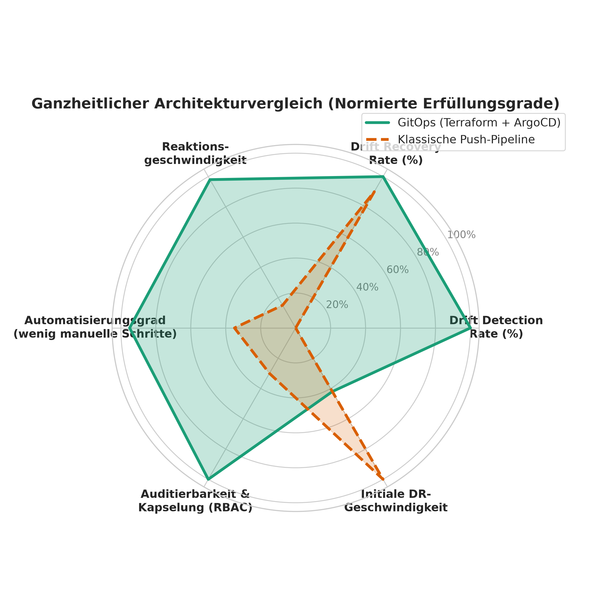

# Empirical Benchmark: GitOps (Terraform & ArgoCD) vs. Push-Based CI/CD Pipelines in Kubernetes


-success)

Dieses Repository enthält das technische Artefakt (Demonstrator & automatisierte Benchmark-Suite) zur Bachelorarbeit:

> **„Konfigurationsdrift und Systemresilienz im Vergleich: Ein empirischer Vergleich Push-basierter Deployment-Pipelines und eines GitOps-Ansatzes mit Terraform und ArgoCD in Kubernetes-Umgebungen“**  
> *Autor: Timo Peters | Studiengang: Informatik (B.Sc.) | Internationale Hochschule (IU)*

---

## 1. Motivation & Problemstellung

In Cloud-nativen Kubernetes-Umgebungen stoßen klassische, **Push-basierte CI/CD-Pipelines** im laufenden Betrieb (*Day-2-Operations*) auf drei strukturelle Schwachstellen:
1. **Configuration Drift:** Manuelle Eingriffe, Hotfixes (`kubectl edit/scale/patch`) oder eingeschleuste Schatten-Ressourcen führen zu einer Abweichung zwischen dem realen Laufzeitzustand (*Ist-Zustand*) und dem im Git-Repository definierten *Soll-Zustand*. Ereignisgesteuerte Push-Pipelines sind im Laufzeitbetrieb blind für solche Drifts.
2. **Sicherheits- & Berechtigungsrisiken („God-Mode“):** Externe CI/CD-Runner benötigen weitreichende administrative Cluster-Zugangsdaten (`kubeconfig` / Cluster-Admin-Tokens), was die Angriffsfläche bei einer Kompromittierung des CI-Systems drastisch erhöht.
3. **Wiederherstellungsaufwand (MTTR & Disaster Recovery):** Rollbacks nach fehlerhaften Releases und die vollständige Re-Initialisierung nach einem Totalausfall erfordern im Push-Modell mehrstufige, imperative Prozessketten.

Dieses Projekt untersucht empirisch, inwiefern eine deklarative **2-Ebenen-GitOps-Architektur** (**Ebene 1:** Basis-Provisioning via *Terraform*, **Ebene 2:** kontinuierliches In-Cluster-Workload-Management via *ArgoCD*) diese Schwachstellen überwindet.

---

## 2. Systemarchitektur im Vergleich



---

## 3. Untersuchungsdesign & Die 10 Drift-Muster (D1–D10)

Beide Deployment-Modelle werden auf identischer Infrastruktur anhand einer **3-Tier-Referenzapplikation** (*Nginx-Frontend*, *HTTP-Echo Backend-API*, *Redis-Datenbank*) in drei experimentellen Szenarien verglichen:

* **UF1 (Drift & Konsistenz):** Automatisierte Injektion von 10 definierten Konfigurationsdrifts (`D1`–`D10`) zur Messung der *Drift Detection Time (s)* und *Drift Recovery Rate (%)*.
* **UF2 (Resilienz & Rollback):** Messung der *Mean Time to Recovery (MTTR in s)* nach dem Ausrollen eines fehlerhaften Container-Releases (`git revert` vs. Pipeline-Redeployment der Vorversion).
* **UF3 (Disaster Recovery & Betriebsaufwand):** Messung der *Disaster Recovery Duration (s)* und der *Anzahl manueller Prozessschritte* bei einem kompletten Cluster-Totalausfall (`terraform destroy`).

### Katalog der injizierten Drift-Muster (`benchmark-suite/run_experiment.py`)

| ID | Drift-Kategorie | Injektions-Vektor (Live-Cluster Sabotage) | Geprüfte Sicherheits-/Betriebsdimension |
| :--- | :--- | :--- | :--- |
| **D1** | Horizontale Skalierung | `kubectl scale deploy frontend --replicas=5` (Soll: 2) | Kapazitäts- & Replikations-Konsistenz |
| **D2** | Unautorisiertes Image-Tag | `kubectl set image deploy/backend-api ...` | Versions- & Supply-Chain-Integrität |
| **D3** | Start-Parameter-Manipulation | `kubectl patch deploy backend-api` (Container-Args) | Konfigurations-Integrität zur Laufzeit |
| **D4** | Service-Port-Verstellung | `kubectl patch svc frontend-service` (Port 80 $\rightarrow$ 8080) | Netzwerk-Verfügbarkeit (Service-Routing) |
| **D5** | Komponenten-Löschung | `kubectl delete svc frontend-service` | Selbstheilung gelöschter Teil-Objekte |
| **D6** | Datenbank-Env-Manipulation | `kubectl set env deploy/database REDIS_AOF_ENABLED=yes` | Schutz kritischer Umgebungsvariablen |
| **D7** | Ressourcen-Limit-Drift | `kubectl set resources deploy/frontend --limits=memory=512Mi` | Quality-of-Service (QoS) & Noisy-Neighbor-Schutz |
| **D8** | Schatten-Ressource (*Shadow-IT*) | Einschleusen einer unautorisierten `ConfigMap` (`rogue-config`) | Bereinigung fremder Objekte (*Pruning*) |
| **D9** | SecurityContext-Eskalation | `allowPrivilegeEscalation: false` $\rightarrow$ `true` | DevSecOps-Compliance & Privilegien-Schutz |
| **D10** | Pod-Ausfall im Live-Betrieb | `kubectl delete pod -l tier=backend` | Abgrenzung K8s-ReplicaSet vs. GitOps-Operator |

---

## 4. Zentrale Ergebnisse & Visualisierungen

Die Auswertung erfolgt deskriptiv (Mittelwert, Median, Standardabweichung) sowie inferenzstatistisch mittels **Mann-Whitney-U-Test** ($\alpha = 0,05$) und der nicht-parametrischen Effektstärke **Cliff's Delta** (`benchmark-suite/evaluate_stats.py`).

### 4.1 Drift Detection & Automated Self-Healing (UF1)
Während eine klassische, ereignisgesteuerte Push-Pipeline im Laufzeitbetrieb architektonisch keine eigenständige Drift-Erkennung besitzt (**0 % Detection Rate**), erkennt der In-Cluster-Operator ArgoCD alle 10 Drift-Muster im Sub-Sekundenbereich (**Mittelwert: 0,36 s**, Median: 0,39 s, $p < 0,001$, Cliff's Delta = $-1,00$). Zudem behebt ArgoCD dank aktivem `prune: true` und `selfHeal: true` **100 % aller Drifts** (Mittelwert: **1,58 s**), während ein klassisches `kubectl apply` im Push-Modell an eingeschleusten Schatten-Ressourcen (**D8**) scheitert (**90 % Recovery Rate**).





### 4.2 Sensitivitätsanalyse: Event-Driven Pull vs. Zeitgesteuerte Push-Intervalle (H1a)
Selbst gegenüber einer periodisch per Cron-Timer ausgeführten Push-Pipeline ($E[T_{\text{wait}}] = T/2$) zeigt das GitOps-Modell über alle untersuchten Intervalle ($T = 5\text{ s}$ bis $300\text{ s}$) einen signifikanten Erkennungsvorteil:



### 4.3 Release-Rollback (UF2) & Disaster Recovery Phasen-Zerlegung (UF3)
Die Phasen-Zerlegung beim kompletten Cluster-Neuaufbau (**UF3**) zeigt einen zentralen architektonischen Trade-off: Während GitOps die notwendigen manuellen Eingriffe auf **einen einzigen deklarativen Schritt** reduziert (H3a bestätigt), führt das initiale Bootstrapping der 7 ArgoCD-Systemkomponenten via Helm zu einem fixen Zeit-Overhead von **~65 Sekunden** gegenüber einem nackten Push-Cluster (H3b differenziert widerlegt):



### 4.4 Ganzheitlicher Architekturvergleich


---

## 5. Projektstruktur

```text
bachelor-gitops-demo/
├── infrastructure/
│   └── main.tf                        # Ebene 1: Terraform IaC (Kind-Cluster & ArgoCD Helm-Release)
├── workloads/
│   ├── argocd-app.yaml                # Ebene 2: Deklarative ArgoCD Application (inkl. Finalizer & Self-Heal)
│   └── base/
│       └── manifest.yaml              # 3-Tier-Referenzarchitektur (Frontend, Backend-API, Redis-DB)
├── benchmark-suite/
│   ├── drift_catalog.py               # CLI-Tool zum isolierten Auslösen einzelner Drift-Muster (D1-D10)
│   ├── run_experiment.py              # Automatisierter Benchmark für UF1 (Drift Detection & Recovery)
│   ├── run_rollback_mttr.py           # Automatisierter Benchmark für UF2 (Release-Rollback & MTTR)
│   ├── run_disaster_recovery.py       # Automatisierter Benchmark für UF3 (Totalausfall & Re-Initialisierung)
│   └── evaluate_stats.py              # Berechnet Mann-Whitney-U, Cliff's Delta & generiert alle 6 Grafiken
├── results/
│   ├── *.csv                          # Erhobene Rohdaten der Messreihen
│   ├── *.log                          # Zeitgestempelte Audit-Logs aller Experimentläufe
│   ├── statistical_summary.txt        # Automatisch generierter Statistik-Bericht
│   └── plots/                         # Hochauflösende Diagramme (300 DPI)
├── Makefile                           # Komfort-Befehle für Setup, Benchmarks und Auswertung
└── README.md                          # Projektdokumentation
```

---

## 6. Schnellstart & Reproduktion der Ergebnisse

### Voraussetzungen
* `docker`, `kind`, `kubectl`, `terraform`, `git` und `python >= 3.10`

### 1. Umgebung initialisieren & Cluster starten
```bash
# Lädt Terraform-Provider und Python-Abhängigkeiten (pandas, scipy, seaborn)
make init

# Baut den Kubernetes-Cluster via Terraform auf und aktiviert ArgoCD GitOps
make up
```

### 2. Experimente & Statistische Auswertung ausführen
```bash
# Einzelne Benchmarks starten:
make test-drift      # UF1: Drift Detection & Self-Healing (D1-D10)
make test-mttr       # UF2: Fehlerhaftes Release & Rollback (MTTR)
make test-dr         # UF3: Disaster Recovery (Terraform Destroy & Apply)

# Statistische Tests (Mann-Whitney-U / Cliff's Delta) & Grafiken generieren:
make stats
```
